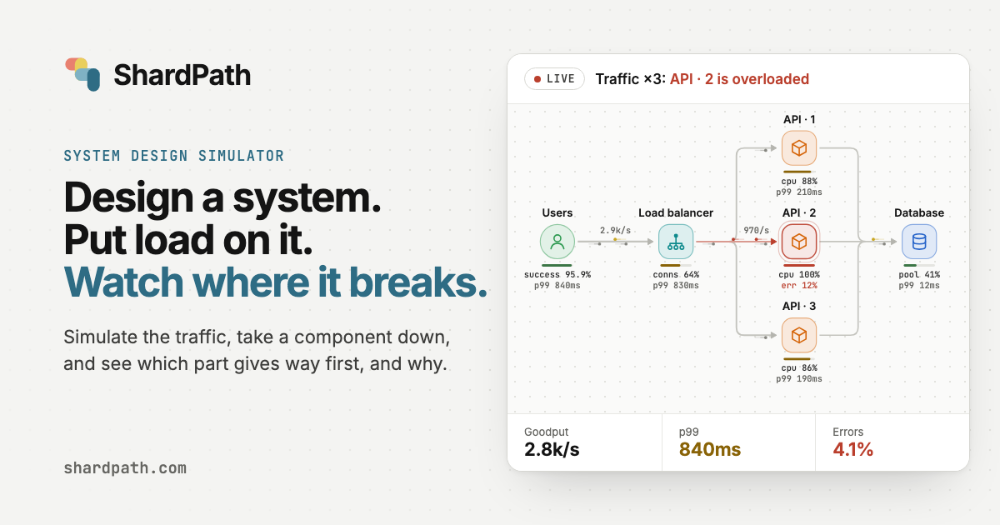

  

<h1 align="center">ShardPath</h1>

<b>Design a system. Put load on it. Watch where it breaks.</b>

  A system design simulator in the browser: draw your architecture, run simulated traffic through a model of it, 
  and see throughput, latency and failures, component by component, as they happen. 
  Use it to learn, to prepare for interviews, to explain a design to your team, or to write up an incident.

  <a href="https://shardpath.com">shardpath.com</a> ·
  <a href="https://x.com/shardpath">@shardpath on X</a> ·
  <a href="mailto:contact@shardpath.com">contact@shardpath.com</a>

  

## What it does

- **Start from an example.** Over seventy ready-made designs, from a single web app to a two-region ride-hailing system, each with failures to switch on and fixes to try. Or start from a blank canvas.
- **Design on a canvas.** Load balancers, services, caches, databases with replicas and shards, event streams and their consumers, CDNs, API gateways, third-party APIs and more, each with the settings that decide how it behaves.
- **Simulate traffic.** A discrete-event engine sends every request through your design. You see p50, p95 and p99 latency, errors, queueing, connection pools and utilisation as they change.
- **Break it on purpose.** Take down a database primary, slow a dependency, kill replicas or lose an availability zone, then watch retries, circuit breakers and autoscaling respond.
- **Find the limit.** See how much more simulated load the design takes before it misses its SLO, and which component gives out first.
- **Replay well-known outages.** Models of them, built from public postmortems, step by step.
- **Share and publish.** Send a link anyone can open and run, or publish a design with its write-up to the gallery.
- **Work with your AI assistant.** An MCP server lets MCP clients such as Claude, Cursor and VS Code build, simulate and review designs with you.

ShardPath is a theoretical simulator: every number it shows comes from a model and the settings given to it, not from measuring a real system.

## What people use it for

Learning system design and preparing for interviews; exploring a design choice on a model and explaining it to a team before writing it up; writing up an incident; and, for teachers and creators, showing a failure live and publishing the design for others to open and run.

---

  ShardPath opens soon. Join the waitlist at <a href="https://shardpath.com">shardpath.com</a>.

